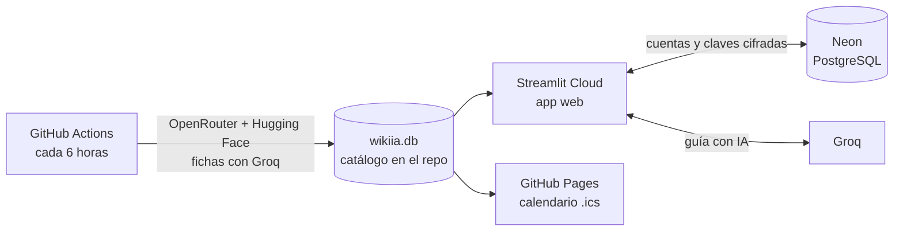

# 🌐 WikiIA

**La enciclopedia de los modelos de inteligencia artificial del mundo.** Reúne en un solo lugar los modelos
de Estados Unidos, China, Francia, Corea, Rusia, Canadá, Japón y más: qué hace cada uno, cuánto cuesta, si se
puede descargar y correr en tu propio computador, qué tan potente es y qué conviene saber sobre la privacidad
según el país de la empresa. Se actualiza sola en la nube cada 6 horas.

| | |
|---|---|
| 🚀 **App** | https://wikiia-bl3pec2wdfzvcxdg9jq5aw.streamlit.app/ (hay que crear una cuenta gratis) |
| 📅 **Calendario de lanzamientos** | https://diegowhite99.github.io/WikiIA/ |
| 🏷️ **Versión estable** | [`v2.1.0`](https://github.com/DiegoWhite99/WikiIA/tree/v2.1.0) · historial en [CHANGELOG.md](CHANGELOG.md) |

Al 5 de noviembre de 2026: **983 modelos** de **85 empresas** en **14 países**.

---

## Qué puede hacer

- **Explorar el catálogo** por país, ranking de potencia, empresa, novedades y estadísticas con gráficos.
- **Ranking con benchmark real**: el orden de «⭐ Más potentes» sale del **Intelligence Index de
  [Artificial Analysis](https://artificialanalysis.ai/)**, que mide a todos los modelos con las mismas pruebas.
  Los que aún no tienen medición van después, con su potencia estimada por WikiIA.
- **Filtrar** por texto, país, empresa, para qué sirve (💻 código · 🔬 investigación · 💬 chat · 👁️ visión ·
  🎨 imágenes · 🎬 video · 🎙️ voz · 🦾 agentes), cómo se usa (nube, local o ambos), costo, potencia y fecha.
- **Ver la ficha completa de cada modelo**: el nombre es el enlace a su página oficial y la casilla de la fila
  abre la ficha (ver la tabla de abajo).
- **Iniciar sesión**: toda la app pide cuenta (nombre, correo y contraseña escrita dos veces). La sesión se
  recuerda 30 días y cada quien puede cambiar su contraseña o borrar su cuenta.
- **Guía con IA** (burbuja verde **W**): te pregunta qué quieres lograr, si lo quieres en la nube o en tu
  computador y con qué equipo cuentas, y te recomienda un modelo del catálogo con los pasos para empezar.
  Usa tu propia clave gratis de Groq, que queda guardada cifrada en tu cuenta.
- **Suscribirse al calendario** de lanzamientos (Google Calendar, Apple, Outlook): cada modelo nuevo aparece
  como un evento.
- **Administración** (solo cuentas root): usuarios registrados, quién guardó clave de Groq, sesiones abiertas
  y borrar cuentas.
- **Tour guiado** la primera vez que alguien entra: ilumina cada parte de la pantalla y explica para qué sirve.

### Qué muestra cada ficha

| Sección | Contenido |
|---|---|
| Identidad | Empresa, país, fecha de publicación, si sigue activo |
| Cómo se usa | ☁️ Nube (API) · 🖥️ Local (pesos abiertos) · ambos |
| Precio | USD por millón de tokens (entrada / salida), gratis o local |
| Sirve para | Capacidades: código, investigación, chat, visión, imágenes, video, voz, agentes |
| Potencia | ★1 a ★5 **medida** con el Intelligence Index de Artificial Analysis o, si no hay medición, **estimada** por WikiIA (máximo ★4) |
| Técnico | Tamaño, contexto, licencia y memoria necesaria |
| ⚠️ Importante | Privacidad y leyes del país, licencia comercial, versiones preview, consejos |
| 📥 Descargar y ejecutar | (modelos locales) Comando listo para copiar en cada motor: Ollama, LM Studio, llama.cpp, Jan, vLLM, SGLang, Transformers, MLX (Mac); para imagen/video: ComfyUI y Diffusers |
| 🖥️ Requisitos mínimos | (modelos locales) Disco, memoria y GPU para 4 bits, 8 bits y original |
| 🌐 Dónde usarlo | Chat oficial, web, API y documentación, precios y proveedores |

Los enlaces se revisan solos: si uno deja de abrir, la app y el calendario usan el siguiente disponible.

---

## Cómo funciona



| Pieza | Dónde corre | Qué hace |
|---|---|---|
| Actualización de datos | **GitHub Actions** (`.github/workflows/actualizar.yml`) | Cada 6 h: 01:17, 07:17, 13:17 y 19:17 (hora de Colombia) |
| Catálogo | `wikiia.db` (SQLite) dentro del repositorio | El robot `wikiia-bot` la sube después de cada actualización |
| App web | **Streamlit Community Cloud** | Toma sola cada cambio del repositorio |
| Cuentas | **Neon** (PostgreSQL gratis) | Usuarios, sesiones y claves de Groq cifradas |
| Calendario | **GitHub Pages** (`.github/workflows/calendario.yml`) | Se vuelve a publicar después de cada actualización |

No hace falta ningún computador encendido: todo corre en la nube.

### En cada actualización

1. **Detecta modelos nuevos** en la API de OpenRouter (modelos en la nube, con precios) y en las
   organizaciones oficiales de Hugging Face (modelos abiertos). Descarta el ruido: copias, versiones
   cuantizadas, LoRA y experimentos. `data/manuales.json` agrega servicios sin API pública (Sora, Veo, Kling,
   Midjourney…).
2. **Reglas automáticas** deducen capacidades, acceso, precio y una potencia inicial.
3. **Benchmark**: descarga el Intelligence Index de Artificial Analysis y lo empareja con cada modelo por su
   nombre. Las estrellas salen de ese puntaje frente al mejor modelo medido (5★ desde el 85 %).
4. **Investigación con IA**: Groq (`openai/gpt-oss-120b`) lee la documentación oficial y redacta 20 fichas en
   español por vuelta. Si estima la potencia, la compara con los mejores modelos del mundo y nunca pasa de ★4.
5. **Revisa los enlaces** nuevos o con más de 14 días.
6. **Guarda la base** en el repositorio y republica el calendario.

---

## Seguridad y datos personales

- **Contraseñas**: nunca se guardan; solo su huella **scrypt** con sal, que no se puede revertir.
  5 intentos fallidos seguidos pausan la cuenta 15 minutos.
- **Claves de Groq**: se guardan **cifradas** (Fernet) con un secreto que no está en la base ni en el código.
  Ni los administradores pueden verlas.
- **Sesiones**: la cookie lleva un código al azar; en la base solo queda su huella SHA-256.
- **Root**: los administradores se definen por la huella SHA-256 de su correo (`ROOTS_SHA256` en
  `wikiia/cuentas.py`) o por el Secret `WIKIIA_ROOTS`. Los correos no aparecen en el código público, y nadie
  puede volverse administrador modificando la base.
- **Errores**: la app nunca muestra errores técnicos ni de los proveedores; siempre dice qué hacer (esperar
  un momento, verificar la clave…).

**Tablas en PostgreSQL**

| Tabla | Llave | Contenido |
|---|---|---|
| `wikiia_usuarios` | `correo` (primaria) | Nombre, huella de la contraseña, clave de Groq cifrada, intentos fallidos, fechas |
| `wikiia_sesiones` | `token_hash` (primaria), `correo` (foránea → usuarios) | Sesiones abiertas y su vencimiento |

---

## Correr en tu computador

Requisitos: Python 3.10 o más reciente.

```bash
git clone https://github.com/DiegoWhite99/WikiIA.git
cd WikiIA
python3 -m venv .venv
.venv/bin/pip install -r requirements.txt
cp .env.example .env          # opcional: clave de Groq, Ollama, Telegram…
./iniciar.sh                  # abre http://localhost:8501
```

- Sin `DATABASE_URL` ni `WIKIIA_SECRETO` en el `.env` **no se pide iniciar sesión** y aparece la pestaña
  ⚙️ Configuración para actualizar, investigar y corregir fichas a mano.
- `WIKIIA_PUBLICO=1` muestra la app tal como se ve en internet (solo lectura).
- Antes de trabajar, trae los datos nuevos que subió el robot con `git pull`.

### Comandos

```bash
.venv/bin/python -m wikiia actualizar              # buscar nuevos + investigar + revisar enlaces + alertar
.venv/bin/python -m wikiia investigar --cantidad 50
.venv/bin/python -m wikiia investigar --modelo deepseek/deepseek-v4.1-flash
.venv/bin/python -m wikiia enlaces [--todos]       # revisar que abran los enlaces
.venv/bin/python -m wikiia benchmarks              # potencia medida (Artificial Analysis)
.venv/bin/python -m wikiia probar-llm              # comprobar Groq y Ollama
.venv/bin/python -m wikiia estado                  # resumen de la base
.venv/bin/python -m wikiia.calendario --carpeta _site
```

---

## Configuración

| Variable | Dónde | Para qué |
|---|---|---|
| `DATABASE_URL` | Secrets de Streamlit Cloud | PostgreSQL de las cuentas (Neon) |
| `WIKIIA_SECRETO` | Secrets de Streamlit Cloud | Cifra las claves de Groq. No cambiarlo después |
| `WIKIIA_ROOTS` | Secrets de Streamlit Cloud (opcional) | Correos administradores extra, separados por comas |
| `GROQ_API_KEY` | Secret del repositorio en GitHub (Actions) | Investigar fichas en la actualización automática |
| `ARTIFICIAL_ANALYSIS_API_KEY` | Secret del repositorio en GitHub (Actions) | Potencia medida con benchmark (clave gratis en artificialanalysis.ai) |
| `TELEGRAM_BOT_TOKEN`, `TELEGRAM_CHAT_ID` | Secret del repositorio (opcional) | Avisos de modelos nuevos por Telegram |
| `GROQ_MODELO_GUIA` | `.env` (opcional) | Modelo de la guía; por defecto `openai/gpt-oss-20b`, con respaldo `gpt-oss-120b` |

`.env.example` explica todas las variables para correrla en tu computador.

**Puesta en marcha en la nube (una sola vez)**

1. Streamlit Community Cloud → *New app* → este repositorio, rama `main`, archivo `app.py`.
2. Neon → crear proyecto → copiar la *connection string* (con `sslmode=require&channel_binding=require`).
3. Streamlit → *Manage app → ⋮ → Settings → Secrets*: `DATABASE_URL` y `WIKIIA_SECRETO`
   (generarlo con `python3 -c "import secrets; print(secrets.token_urlsafe(32))"`). Las tablas se crean solas.
4. GitHub → *Settings → Pages → Source: GitHub Actions*.
5. GitHub → *Settings → Secrets and variables → Actions*: `GROQ_API_KEY` y `ARTIFICIAL_ANALYSIS_API_KEY`.

---

## Estructura

```
app.py                      interfaz completa (login, filtros, pestañas, fichas, guía, administración)
wikiia/
  actualizador.py           la actualización completa (fuentes → reglas → IA → enlaces → alertas)
  fuentes/                  OpenRouter y Hugging Face
  catalogo.py, heuristicas.py  empresas, países y reglas automáticas (capacidades, potencia, enlaces)
  investigador.py, llm.py   fichas con IA (Groq, con Ollama de respaldo en el PC)
  motores.py                comandos de descarga y requisitos para cada motor local
  chat.py                   guía con IA (herramienta buscar_modelos, reintentos y mensajes amables)
  cuentas.py                cuentas en PostgreSQL (login, sesiones, root, claves cifradas)
  enlaces.py                revisión de enlaces
  benchmarks.py             potencia medida con el Intelligence Index de Artificial Analysis
  calendario.py             calendario .ics y su página
  db.py, config.py          base SQLite y configuración
  static/                   tour guiado (driver.js)
data/                       empresas, países y catálogo manual (JSON)
.github/workflows/          actualización automática y calendario
wikiia.db                   catálogo (lo actualiza el robot)
```

---

## Versiones

Versionado semántico (`MAYOR.MENOR.PARCHE`): cada cambio se publica con un tag anotado en GitHub.
**La versión estable para revisión es `v2.1.0`**. Los cambios de cada versión están en
[CHANGELOG.md](CHANGELOG.md). Las dependencias están fijadas en `requirements.txt` con las versiones probadas.

## Límites conocidos

- La **potencia medida** depende de que Artificial Analysis haya evaluado el modelo. Los demás tienen una
  potencia **estimada** (tamaño, precio y documentación), que nunca pasa de ★4.
- Las fichas se investigan de a 20 por actualización: las que faltan se completan en unos días.
- La guía depende del plan gratis de Groq (unos 8 000 tokens por minuto): si se llena, pide esperar unos
  segundos.
- Si la app pasa varios días sin visitas, Streamlit la pone a dormir: toca **«Yes, get this app back up»** y
  espera un minuto.
- GitHub puede retrasar unos minutos las tareas programadas.

## Créditos

- Datos: [OpenRouter](https://openrouter.ai) y [Hugging Face](https://huggingface.co).
- Benchmark: Intelligence Index de [Artificial Analysis](https://artificialanalysis.ai/).
- IA: [Groq](https://groq.com) (`gpt-oss`) y [Ollama](https://ollama.com).
- Tour guiado: [driver.js](https://driverjs.com) (licencia MIT, en `wikiia/static/driverjs`).
- Hecho con [Streamlit](https://streamlit.io), SQLite y PostgreSQL ([Neon](https://neon.tech)).

Autor: **Diego Castelblanco** ([DiegoWhite99](https://github.com/DiegoWhite99)).
